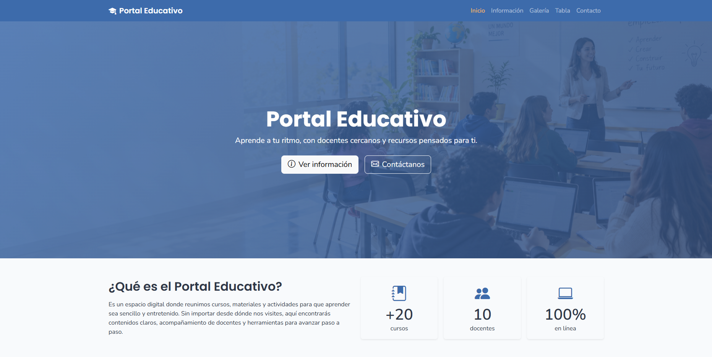

<p align="center">
  
</p>

<h1 align="center">Portal Educativo</h1>

<p align="center">
  
</p>

Portal web temático con recursos, información y actividades educativas. Proyecto individual desarrollado con HTML5, Bootstrap 5, CSS y JavaScript propios, publicado en GitHub Pages.

🔗 **Sitio publicado:** [https://soypadierna.github.io/soypadierna_portal/](https://soypadierna.github.io/soypadierna_portal/)

## Tecnologías

- HTML5 semántico (`header`, `nav`, `main`, `section`, `article`, `aside`, `footer`)
- [Bootstrap 5.3](https://getbootstrap.com/) (CDN)
- [Bootstrap Icons](https://icons.getbootstrap.com/) (CDN)
- CSS3 (variables en `:root`, Flexbox y CSS Grid)
- JavaScript (vanilla, sin librerías)
- Google Fonts (Poppins y Nunito)

## Estructura del proyecto

```text
portal-educativo/
├── index.html
├── informacion.html
├── galeria.html
├── tabla.html
├── contacto.html
├── template.html
├── css/
│   └── style.css
├── js/
│   └── script.js
├── img/
└── README.md
```

## Páginas

| Página | Descripción |
|--------|-------------|
| `index.html` | Inicio: hero, resumen, accesos rápidos, cursos destacados e inscripciones |
| `informacion.html` | Misión, visión, cursos, preguntas frecuentes (accordion) y docentes |
| `galeria.html` | Galería de 8 imágenes y video incrustado |
| `tabla.html` | Oferta académica con tabla, totales y notas de lectura |
| `contacto.html` | Formulario de contacto con validación en tiempo real |

## Características

- **Responsive:** diseño adaptable con la grilla y los breakpoints de Bootstrap.
- **Navegación común:** navbar con página activa marcada (`active` + `aria-current`) y footer iguales en todas las páginas.
- **Validación en tiempo real:** nombre, correo, motivo, mensaje (con contador de caracteres) y política de datos; mensajes de error específicos y alertas de Bootstrap, sin `alert()`.
- **Galería:** grilla uniforme (`aspect-ratio` + `object-fit`) con efecto zoom al pasar el mouse.
- **Tabla:** `table-striped` y `table-hover` con badges de modalidad y totales verificados.
- **Accesibilidad:** `alt` descriptivos, `aria-label` en secciones y componentes, jerarquía de títulos correcta.
- **Identidad visual:** paleta y tipografías definidas con variables CSS y variables de Bootstrap sobrescritas.

## Ejecutar en local

1. Clona el repositorio:
   ```bash
   git clone https://github.com/soypadierna/portal-educativo.git
   cd portal-educativo
   ```
2. Abre `index.html` directamente en el navegador, o usa un servidor local:
   ```bash
   # Con Python
   python -m http.server 8000

   # Con Node.js
   npx serve
   ```
3. Visita `http://localhost:8000` (o la URL que indique el servidor).

> Se requiere conexión a internet para cargar Bootstrap, Bootstrap Icons y Google Fonts desde sus CDN.

## Créditos de imágenes

Las imágenes del directorio `img/` provienen de:

- Imágenes generadas con inteligencia artificial.
- Imágenes libres de derechos.

Las imágenes y el contenido de ejemplo (docentes, cursos, datos de contacto) son ficticios y se usan con fines académicos.

## Autor

**Santiago Padierna** · [@soypadierna](https://github.com/soypadierna)
**Camilo Mejia** · [@carlosmejia327-dot](https://github.com/carlosmejia327-dot)

Proyecto académico, 2026.